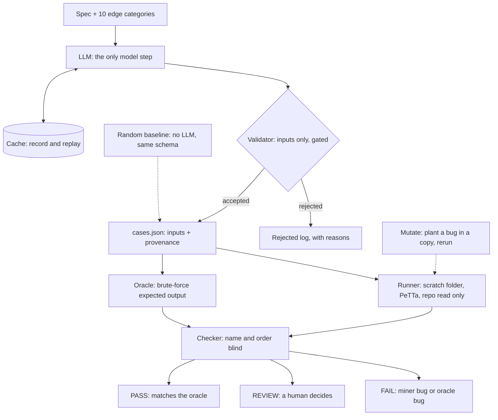

# minegen

LLM-proposed, oracle-verified regression tests for the Hyperon pattern miner (MeTTa/PeTTa).

An LLM writes tricky test inputs. A separate brute-force Python oracle computes the correct answers. The real
miner runs through PeTTa and is graded against the oracle. The LLM never decides what is correct, and it never
runs at mining time.

Status: working prototype. It has been run twice against a real PeTTa with Gemini-proposed cases, and 57 unit
tests pass. The bug-catching comparison against a random baseline has not been run yet (see
[Status and results](#status-and-results)).

## Contents

- [Why](#why)
- [How it works](#how-it-works)
- [Quick start](#quick-start)
- [Commands](#commands)
- [Configuration](#configuration)
- [Edge cases](#edge-cases)
- [Reading the output](#reading-the-output)
- [Why `mutate` takes longer](#why-mutate-takes-longer)
- [Project layout](#project-layout)
- [Testing](#testing)
- [Status and results](#status-and-results)
- [Troubleshooting](#troubleshooting)
- [Limitations](#limitations)

## Why

Observations from reading the `hyperon-miner` repo (branch `petta-main`):

- `scripts/run-tests.py` runs a whitelist of 8 test files. `test-frequent-pattern-miner.metta` and three other
  frequent-miner test files are not on it.
- The frequent-miner tests compare with a literal `==` against PeTTa-generated variable names such as
  `$_232438`. The repo ships `assertAlphaEqual`, which they do not use.
- Expected values are a fixed snapshot written by hand into the test. They are not computed independently, so
  they cannot reveal a defect nobody thought to look for.
- Most tests use the same dataset (`ugly_man_sodaDrinker`).

minegen adds independently computed expectations and a way to generate unusual inputs. Its first real finding is
described under [Status and results](#status-and-results).

## How it works



| Stage | What it does |
|---|---|
| Propose | The LLM gets a spec and the edge categories and returns JSON proposals: a small dataset plus miner settings. Replies are cached, so a run can be replayed offline and deterministically. |
| Validate | A deterministic gate keeps only ground atoms within size limits, drops duplicates, and rejects any proposal that carries expected results. Rejections are kept with reasons. |
| Oracle | Plain Python counts matches the slow way and produces the expected patterns and supports. It reproduces the repo's own golden output exactly, in both modes. |
| Run | A driver in a temporary folder imports the miner from the repo by absolute path and runs it through PeTTa. The repo is only read, never copied or written. |
| Check | A name- and order-blind comparison gives PASS, REVIEW or FAIL. |
| Mutate | Plants known bugs one at a time in a copy of the repo and counts which suite notices. |

What the miner returns, as the oracle models it:

- With `conj_exp` false, the single-clause patterns that reach minimum support (including fully ground ones).
- With `conj_exp` true, the two-clause conjunctions only, never the single clauses. A conjunction may join on
  several shared variables and may map several variables of a clause onto one.

## Quick start

Requirements: Python 3.9 or newer (standard library only), the
[hyperon-miner](https://github.com/iCog-Labs-Dev/hyperon-miner) repo on branch `petta-main`, and
[PeTTa](https://github.com/patham9/PeTTa) with SWI-Prolog and its Janus library. On Windows, use WSL.

Recommended layout. `minegen` can live anywhere, but a sibling folder needs no configuration:

```
work/
  hyperon-miner/      git clone, branch petta-main
  minegen/            this folder; run every command from here
```

```bash
cd work/minegen
python3 -m unittest discover -s tests          # 57 tests, no PeTTa needed
python3 -m minegen generate                    # offline: hand-written fixture cases
python3 -m minegen check                       # grade the real miner on them
```

To use a real model, copy `.env.example` to `.env`, set `MINEGEN_BACKEND=gemini` and `MINEGEN_API_KEY`, then run
`generate` again.

The repo and PeTTa are found automatically:

- Repo: `--repo`, then `HYPERON_MINER_DIR`, then `../hyperon-miner`.
- PeTTa: `--petta-run`, then `PETTA_RUN`, then `petta` or `run.sh` on `PATH`, then `~/PeTTa/run.sh`.
  minegen runs `run.sh` from its own folder, like `cd ~/PeTTa && sh run.sh file.metta`, with the `silent` flag.

## Commands

| Command | What it does |
|---|---|
| `generate` | Propose cases and write `cases.json`. Backends: `fixture` (default), `gemini`, `anthropic`, `replay`, `random`. |
| `generate --backend random --count 20 --seed 0 --out cases_random.json` | The no-LLM baseline, same schema and same validator. |
| `oracle [name]` | With no name, list the cases. With a name or id prefix, print the dataset and the expected output. |
| `coverage` | Which edge conditions the cases exercise, compared with a random set of the same size. |
| `check` | Run every case through the real miner and grade it. Writes `check_report.json`, and `duplicates_report.md` if duplicates appear. |
| `check --only a,b --show-output` | Run just those cases, print PeTTa's last 3000 characters, and save the full text to `check_raw/`. |
| `mutate` | Plant each seeded bug in a copy of the repo and rerun the suites. See [Why `mutate` takes longer](#why-mutate-takes-longer). |

Useful flags: `--cases FILE`, `--timeout SECONDS` (default 300), `--env-file FILE`, and for `mutate`:
`--mutants M1,M5`, `--skip-repo-tests`, `--workers N`, `--seed N`.

Note that `generate` overwrites `cases.json` unless you pass `--out`. Use one file per source, for example
`cases_gemini.json` and `cases_random.json`.

## Configuration

Priority: command-line flag, then real environment variable, then `.env`, then default. Copy `.env.example` to
`.env` and keep `.env` out of git.

| Variable | Meaning | Default |
|---|---|---|
| `MINEGEN_BACKEND` | `fixture`, `gemini`, `anthropic`, `replay` or `random` | `fixture` |
| `MINEGEN_MODEL` | Model id for the chosen backend | `gemini-2.5-flash` or `claude-sonnet-5-5` |
| `MINEGEN_API_KEY` | Key for whichever backend is chosen | none |
| `GEMINI_API_KEY`, `GOOGLE_API_KEY`, `ANTHROPIC_API_KEY` | Provider keys, used if `MINEGEN_API_KEY` is unset | none |
| `HYPERON_MINER_DIR` | hyperon-miner checkout | `../hyperon-miner` |
| `PETTA_RUN` | PeTTa launcher: a file, a command name, or a folder holding `run.sh` (`~` is expanded) | `petta` or `run.sh` on `PATH`, else `~/PeTTa/run.sh` |
| `PETTA_FLAGS` | Extra arguments after the file. `silent` stops PeTTa printing the source of every loaded function. Set it empty to disable | `silent` |
| `MINEGEN_CACHE` | Folder for recorded model replies | `.minegen_cache` |

Keys are never written to the cache, to `cases.json`, or to any report.

## Edge cases

Each case tries to break the miner in one specific way. A pass means no bug was found for that dataset, not that
the miner is correct.

| Category | What it is | What it probes | Seeded bug it would expose |
|---|---|---|---|
| `boundary_minsup` | a pattern with support exactly minsup, another with minsup minus 1 | `>=` versus `>` in the support check | M1, M2, M5 |
| `join_gain` | a join whose support exceeds each clause (3 x 3 = 9) | conjunction support counting and the minsup check on joins | M3 |
| `self_link` | atoms with repeated arguments, such as `(Inheritance D D)` | repeated-variable patterns | none seeded |
| `nothing_frequent` | no pattern reaches minsup | empty results, no crash | none seeded |
| `single_atom` | a one-atom database | smallest search, ground patterns | none seeded |
| `single_value_column` | one constant in every atom | a constant pattern equal to the abstract one | none seeded |
| `ternary_links` | three-argument links | variable sharing across more positions | none seeded |
| `mixed_link_types` | several link types over the same symbols | heads not mixed up, joins across link types | none seeded |
| `nested_atoms` | atoms containing sub-expressions | constructs the miner may not support (REVIEW only) | none seeded |
| `duplicate_atoms` | the same atom listed twice | multiplicity in support | M4 |

Seeded bugs (`minegen/mutants.py`): M1 and M2 flip `>=` to `>` in the single-clause and conjunction support
checks. M3 makes conjunction expansion ignore minsup. M4 dedups matches inside `counter` (may be a no-op if the
space already dedups). M5 inverts the check and is a control that every suite should catch.

## Reading the output

| Verdict | Meaning |
|---|---|
| `PASS` | The miner's output matches the oracle. |
| `FAIL` | A timeout, non-zero exit, unreadable output, wrong support, a pattern below minsup, a duplicate report, or a frequent pattern the miner left out. A FAIL is not automatically a miner bug. Read the raw output to decide whether the miner or the oracle is wrong. |
| `REVIEW` | A human decides. Used for categories the repo does not define (nested atoms, duplicate atoms, numbers), for patterns outside the oracle's space, and when completeness cannot be checked. |

A duplicate report says what kind it is: the same clauses in a different order, or identical up to variable names.
`check` prints each duplicate exactly as the miner printed it and writes `duplicates_report.md` with the dataset,
the settings and the copies.

## Why `mutate` takes longer

`check` runs each case once. `mutate` runs the whole suite once for every variant of the miner, so the count
multiplies:

```
variants          = 1 clean + 5 planted bugs                       = 6
runs per variant  = 9 repo test files + 20 generated + 20 random   = 49
total             = 6 x 49                                         = 294 PeTTa runs
```

- **Every run starts a new Prolog process** and loads the miner. The generated and random cases took about
  0.4 to 0.9 seconds each in measured runs, so the 240 case runs are a couple of minutes at most.
- **The repo's own test files are the slow part.** Each loads the whole miner, and some use large data (one
  dataset has about 16,000 lines) or the heavier surprisingness code. They have not been timed here. A single
  stuck file costs up to `--timeout` (300 seconds), so the worst case is 6 x 9 x 300 seconds.
- **A planted bug needs its own copy of the repo**, because it edits source files. The repo is copied once into a
  temporary folder and each variant is copied from there. That first copy took 271 seconds from `/mnt/d` in one
  measured run, and takes seconds when the repo is under `~`.
- **`mutate` prints its plan and progress** (variant count, run count, time per phase), so a long run does not
  look hung.

To speed it up:

```bash
python3 -m minegen mutate --skip-repo-tests              # case runs only: the quick pilot
python3 -m minegen mutate --mutants M1,M5                # fewer variants
python3 -m minegen mutate --workers 4 --timeout 120      # more parallelism, fail faster
cp -r /mnt/d/<path>/hyperon-miner ~/hyperon-miner        # keep the repo on the WSL filesystem
```

Time one repo test by hand first (`time petta <file>`) to know what to expect from the full run.

## Project layout

```
minegen/
  README.md
  .env.example            copy to .env
  .gitignore
  fixtures/handwritten_proposals.json    offline sample cases (hand-written, not model output)
  minegen/
    cli.py                commands and discovery of the repo and PeTTa
    llm.py                Gemini, Anthropic, replay and fixture backends, prompt, cache
    validator.py          the gate between the LLM and the test suite
    oracle.py             brute-force expected output
    runner.py             writes the scratch driver, runs PeTTa
    check.py              compares miner output with the oracle, finds duplicates
    mutants.py            seeded bugs and the mutate harness
    baseline.py           random-dataset baseline
    sexpr.py              s-expression parser, alpha-canonical form
    envfile.py            .env loader
  tests/test_minegen.py   57 tests
```

## Testing

```bash
python3 -m unittest discover -s tests
```

The tests need no PeTTa. If a `hyperon-miner` checkout is found, two more checks run against it: the oracle must
reproduce the repo's golden output with full equality in both modes, and every seeded-bug target must exist
exactly once. One test replays the miner's real output for a one-atom database (copied from a real run) and expects
exactly 4 unique conjunctions and 2 duplicates.

## Status and results

Verified by running:

- The oracle reproduces the repo's golden output on `ugly_man_sodaDrinker` in both modes: 6 single-clause
  patterns (`conj_exp` false) and 16 conjunctions (`conj_exp` true), with the same supports.
- The checker returns FAIL for each simulated fault, and REVIEW where the repo does not define the behavior.
- Two real runs of 20 Gemini-proposed cases (`gemini-3.5-flash-lite`). Run 1: PASS 8, REVIEW 5, FAIL 7, mostly
  from three wrong assumptions in the first oracle, since fixed. Run 2: PASS 14, REVIEW 3, FAIL 3.

The finding: the miner reports **duplicate conjunctions** on edge-case data. All three FAILs in run 2 are this
defect. 18 patterns were printed twice across 5 cases, always in conjunction mode, and the mentor confirmed that
duplicates should not happen. The smallest example is one atom, `(Singleton element x)`, with minsup 1, which
prints 6 results of which only 4 are distinct. The repo's own golden output has no duplicates.

Where it comes from (a lead from reading the code, not yet tested): it is not the specialization stage. The
candidate lists the miner prints are unique in every case, and the 10 non-conjunction cases have no duplicates.
In the conjunction stage the same conjunction is built more than once and stored, `unique-atom` compares atoms
literally so copies with different variable ids survive, and `sort_conj` orders clauses by a global first-seen
index, so equal conjunctions can differ in their ids or in clause order. 

Not done yet:

- Testing the duplicate fix (`alpha-unique-atom`) on a copy of the repo.
- A quick coverage check showed random data matches or beats the Gemini cases on self-links and join gain. Only
  the single-atom and nested cases are ones random cannot produce, so the LLM's advantage is a hypothesis.

## Troubleshooting

| Symptom | Cause and fix |
|---|---|
| `PeTTa launcher not found` | `petta` is probably a shell function or alias, which Python cannot see. Set `PETTA_RUN=~/PeTTa/run.sh`, or put a real script on `PATH`. |
| `check` seemed to hang | It prints nothing until a case finishes in old versions. Update, and use `--only` with `--timeout 120` first. |
| `cases file not found: 'x.json.'` | A trailing `.` from copying a command out of a sentence. Current versions strip it. |
| Output is thousands of lines of Prolog | PeTTa printed the source of every loaded function. Make sure `PETTA_FLAGS` is not set empty. |
| `no API key: set MINEGEN_API_KEY ...` | Set a key in `.env` or the environment. Check that `MINEGEN_BACKEND` is the backend you meant. |
| Gemini returns HTTP 404 | The model name is wrong. Set `MINEGEN_MODEL` to a current id. |
| `python: command not found` in WSL | Use `python3`. |
| Everything copies slowly | The repo is on a `/mnt/...` drive. Keep it under `~`. |

## Limitations

- The oracle covers flat data at depth 0, with datasets of up to 30 atoms (it uses a simple nested-loop join).
- Nested atoms, duplicate atoms and numbers are marked uncertain and can only produce REVIEW.
- Surprisingness (`isurp`, `jsd`) is out of scope.
- The 11 fixture cases are hand-written stand-ins, not model output.
- Gemini is not deterministic. Record a run with the cache and replay it for reproducible results.
- Passing cases do not prove the miner correct. They only fail to find a bug.