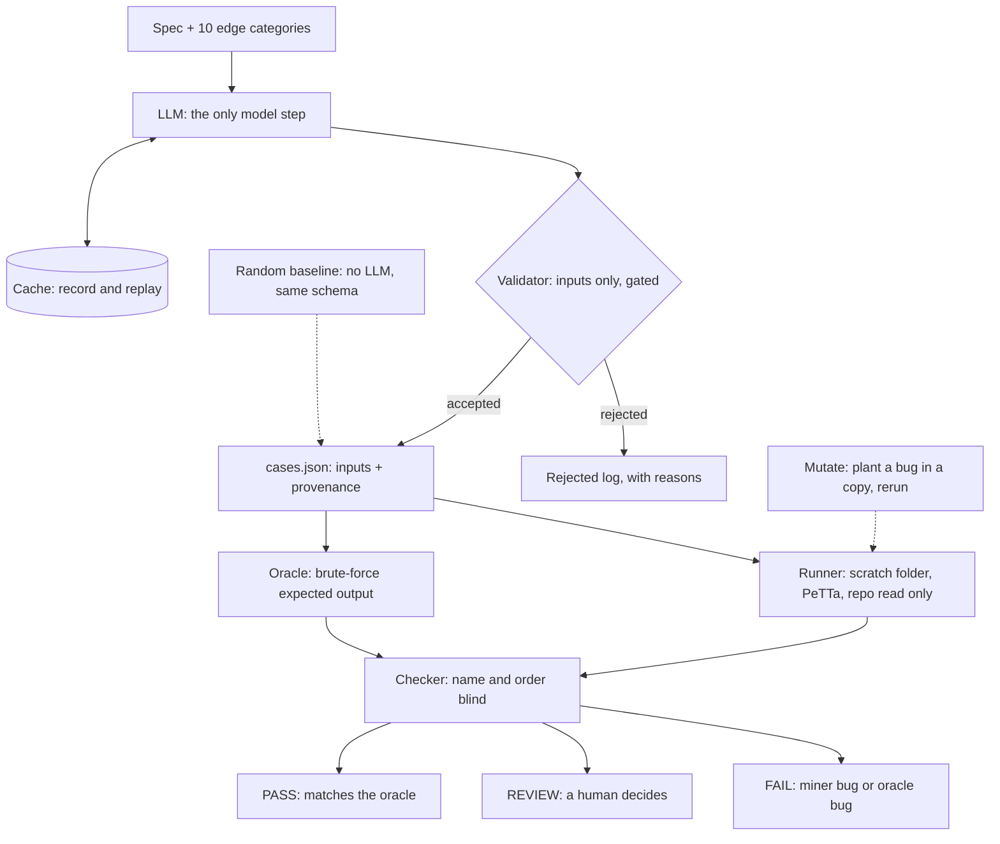

# minegen: LLM-proposed, oracle-verified regression tests for the Hyperon pattern miner

An LLM proposes tricky test inputs. A separate brute-force Python oracle computes the correct answers.
The miner is graded against the oracle. The LLM never decides what is correct and never runs at mining time.

## 1. Problem (evidence from reading the repo, branch `petta-main`)

- `scripts/run-tests.py` runs only a whitelist of 8 test files. `test-frequent-pattern-miner.metta`,
  `test-conjunction-expansion.metta`, `test-candidate-patterns.metta` and `test-build-specialization.metta`
  are not on it, so CI covers the frequent miner only through `test-pattern-miner.metta`.
- The frequent-miner tests assert with `assertEqual`, which is a literal `==`, against PeTTa-generated
  variable names such as `$_232438`. The repo already provides `assertAlphaEqual`, which the tests do not use.
- 5 of the 10 dataset imports across the tests use the same file, `ugly_man_sodaDrinker`. No test targets
  boundaries (support exactly equal to minsup), empty results, single-atom data or nested atoms.
- Expected values are a fixed snapshot written by hand into the test. They are not computed independently, so
  they cannot reveal a defect nobody thought to look for.

## 2. Hypothesis

At the same number of test cases, LLM-proposed edge cases catch more seeded miner bugs than random
datasets and than the repo's existing tests, with zero false failures on the unmodified miner.
Metric: seeded bugs caught (`minegen mutate`), plus false-FAIL count on the clean miner.
This is a hypothesis. Nothing here supports it yet (see section 5).

## 3. Architecture



Boundaries and interfaces

| Boundary | Rule |
|---|---|
| LLM boundary | The model sees the spec and the category list and returns JSON proposals. It never sees miner output and never produces expected values |
| Validator | Deterministic gate: ground atoms only, size limits, dedup, rejects any `expected` field. Rejections are kept with reasons |
| Cache | Every model reply is stored by prompt, so a run can be replayed offline and deterministically (`--backend replay`) |
| Runner | Writes the data file and a driver into a scratch folder and imports the miner from the repo by absolute path. The repo is only read |
| Oracle | Independent brute-force reference, checked against the repo's own golden output |
| Mutate | Plants one bug at a time in a copy of the repo and reruns the same pipeline, to count which suite notices |

Failure paths: timeout, non-zero exit, unparseable output, a wrong support, a duplicate report and a
frequent pattern the oracle expects but the miner left out are all FAIL. A FAIL is not automatically a
miner bug: read the raw output (`check --only <case> --show-output`) to decide whether the miner or the
oracle is wrong. Cases in categories whose semantics the repo does not pin down (nested atoms, duplicate
atoms, numbers) can only produce REVIEW, and so can patterns the miner reports that the oracle's space
does not contain.

### Edge cases and what each one probes

| Category | What it is | What it probes | Seeded bug it would expose |
|---|---|---|---|
| boundary_minsup | a pattern with support exactly minsup, another with minsup minus 1 | `>=` versus `>` in the support check | M1, M2, M5 |
| join_gain | a join whose support exceeds each clause (3 x 3 = 9) | conjunction support counting and the minsup check on joins | M3 |
| self_link | atoms with repeated arguments, such as `(Inheritance D D)` | repeated-variable patterns | none seeded |
| nothing_frequent | no pattern reaches minsup | empty results, no crash | none seeded |
| single_atom | a one-atom database | smallest search, ground patterns | none seeded |
| single_value_column | one constant in every atom | a constant pattern equal to the abstract one | none seeded |
| ternary_links | three-argument links | variable sharing across more positions, multi-variable joins | none seeded |
| mixed_link_types | several link types over the same symbols | heads not mixed up, joins across link types | none seeded |
| nested_atoms | atoms containing sub-expressions | constructs the miner may not support (REVIEW only) | none seeded |
| duplicate_atoms | the same atom listed twice | multiplicity in support | M4 |

Oracle scope: support of any pattern; full expected output for flat data at depth 0. The miner's formatter
returns either the single-clause patterns (`conj_exp` false) or the two-clause conjunctions (`conj_exp` true),
never both, and the oracle does the same. Fully ground patterns count when their support reaches minsup, and
conjunctions may join on several shared variables and may map several variables of a clause onto one (giving a
repeated-variable clause such as `(Ref $a $a)`), because the miner builds conjunctions by that substitution.
Deeper conjunctions get soundness checks only.

## 4. Setup and use

Layout (put `minegen` next to the repo, not inside it):

```
work/
  hyperon-miner/      git clone, branch petta-main
  minegen/            this folder; run every command from here
```

minegen itself can live anywhere. Only `check` and `mutate` need the repo. `check` only reads it: the generated
driver lives in a temporary folder and imports the miner by absolute path, so nothing is copied or written.
`mutate` copies the repo once into a temporary folder (it has to edit source files to plant bugs). The repo is found from `--repo`, then `HYPERON_MINER_DIR`, then
`../hyperon-miner`. PeTTa is found from `--petta-run`, then `PETTA_RUN`, then `petta` (or `run.sh`) on your
`PATH`, then `~/PeTTa/run.sh`. If your `petta` is a shell function or alias, Python cannot see it, but
`~/PeTTa/run.sh` is found automatically (minegen runs it from that folder, like `cd ~/PeTTa && sh run.sh file`). Shell aliases and variables that are not exported are invisible
to Python.

Configuration. Priority is command-line flag, then real environment variable, then `.env` file, then default.
Copy `.env.example` to `.env` and fill it in, or export the variables yourself.

| Variable | Meaning | Default |
|---|---|---|
| `MINEGEN_BACKEND` | `fixture`, `gemini`, `anthropic` or `replay` | `fixture` |
| `MINEGEN_MODEL` | model id for the chosen backend | `gemini-2.5-flash` or `claude-sonnet-5-5` |
| `MINEGEN_API_KEY` | key for whichever backend is chosen | none |
| `GEMINI_API_KEY`, `GOOGLE_API_KEY` | Gemini key if `MINEGEN_API_KEY` is unset | none |
| `ANTHROPIC_API_KEY` | Anthropic key if `MINEGEN_API_KEY` is unset | none |
| `HYPERON_MINER_DIR` | hyperon-miner checkout, used by `check` and `mutate` | `../hyperon-miner` |
| `PETTA_RUN` | PeTTa launcher: a file, a command name, or the folder holding `run.sh` (`~` is expanded) | `petta` or `run.sh` on `PATH`, else `~/PeTTa/run.sh` |
| `PETTA_FLAGS` | extra arguments placed after the file; `silent` stops PeTTa printing the source of every loaded function. Set empty to disable | `silent` |
| `MINEGEN_CACHE` | folder for recorded model replies | `.minegen_cache` |

Keys are never written to the cache, to `cases.json`, or to any report.

```
python -m minegen generate                                   # uses MINEGEN_BACKEND (default: fixture)
python -m minegen generate --backend gemini --per-category 2 # one-off override
python -m minegen generate --backend replay                  # re-run a recorded reply, deterministic
python -m minegen oracle exact_minsup_boundary               # print expected output for one case
python -m minegen generate --backend random --count 20 --seed 0 --out cases_random.json   # the no-LLM baseline
python -m minegen check --cases cases_random.json            # same check, random data: does it find the duplicates too?
python -m minegen coverage                                   # edge-condition coverage vs random baseline
python -m minegen check                                      # repo and PeTTa are auto-detected, see above
python -m minegen check --only exact_minsup --show-output     # one case, with PeTTa's raw output
python -m minegen mutate
python -m unittest discover -s tests
```

Needs Python 3.9+, no third-party packages. `check` and `mutate` need PeTTa with Janus.

Seeded bugs (`mutants.py`, applied to a copy of the repo, each target text verified to occur once):
M1 and M2 flip `>=` to `>` in the single-clause and conjunction support checks. M3 makes conjunction
expansion ignore minsup. M4 dedups matches inside `counter` (may be equivalent if the space
already dedups). M5 inverts the check and is a control that every suite should catch.

## 5. What has and has not been verified

Verified by running (unit tests, plus one real PeTTa run on 18 Nov 2026):
- The oracle reproduces the repo's golden output for `ugly_man_sodaDrinker` with full equality in both modes:
  the 6 single-clause patterns (`conj_exp` false) and the 16 conjunctions (`conj_exp` true), same supports.
  It also reproduces the deck's worked example (supports 3, 2, 1, 1, 1) and the 3 x 3 join giving 9.
- The checker returns PASS for correct output and FAIL for each simulated fault.
- The validator, cache and replay, runner plumbing and the mutation targets (also confirmed on the real checkout).
- Two real runs of 20 Gemini-proposed cases (`gemini-3.5-flash-lite`). First run: PASS 8, REVIEW 5, FAIL 7, mostly
  from three wrong assumptions in the first oracle (conjunction mode returns conjunctions only, ground patterns
  are reported, joins can share several variables). After fixing the oracle: PASS 14, REVIEW 3, FAIL 3. All three
  remaining FAILs are one suspected miner defect: the same conjunction is reported twice. See
  `docs/3_other_things_to_know.md` section 13.

Not verified:
- That the duplicate-conjunction report is a real miner defect and that the suggested fix removes it (a lead, not
  yet tested), and the open questions about repeated-variable conjunctions and numeric constants.

## 6. Limits

Oracle runs a naive nested-loop join, so datasets are capped at 30 atoms. Depth is fixed at 0.
Surprisingness (`isurp`, `jsd`) is out of scope. If PeTTa spaces dedup duplicate atoms, M4 is an
equivalent mutant and the duplicate-atom case will show REVIEW.